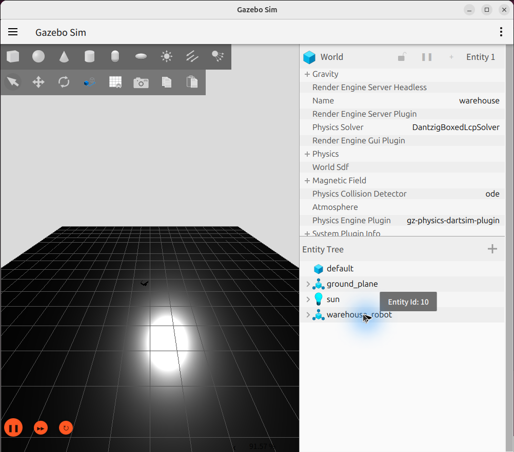
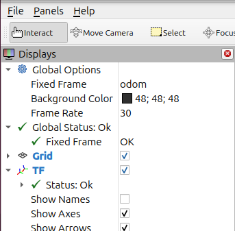
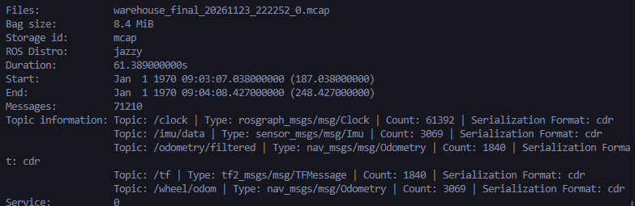

# 仓库差速机器人仿真

在 Ubuntu 24.04 上使用 ROS 2 Jazzy 和 Gazebo Harmonic 的最小仿真。从 ROS 发布速度，小车在 Gazebo 中行驶，轮速里程计和 IMU 经桥接送入 `robot_localization`，输出平面位姿估计和 `odom → base_link`。



## 构建和启动

需要 ROS 2 Jazzy、`colcon`、Gazebo Harmonic、`ros_gz_sim`、`ros_gz_bridge` 和 `robot_localization`。RViz 与 `ros2 bag` 分别用于可视化和记录。下面从本仓库根目录运行。

```bash
source /opt/ros/jazzy/setup.bash
colcon build --packages-select warehouse_robot_sim --cmake-args -DBUILD_TESTING=OFF
source install/local_setup.bash
export ROS_DOMAIN_ID=48 GZ_PARTITION=warehouse_robot_final
ros2 launch warehouse_robot_sim sim.launch.xml
```

启动日志出现 `Entity creation successful.` 后，保持该终端运行。新终端需要各自加载 Jazzy，并使用同一个 ROS 域。Gazebo GUI 还需要相同的 Gazebo 分区。

| 用途 | 在加载 Jazzy 的对应终端运行 |
| --- | --- |
| 虚拟机桌面打开 Gazebo | `GZ_PARTITION=warehouse_robot_final gz sim -g --force-version 8` |
| 虚拟机桌面打开 RViz | `ROS_DOMAIN_ID=48 ros2 run rviz2 rviz2 --ros-args -p use_sim_time:=true` |
| 检查 TF 发布者 | `ROS_DOMAIN_ID=48 ros2 topic info /tf -v` |
| 检查车体变换 | `ROS_DOMAIN_ID=48 ros2 run tf2_ros tf2_echo odom base_link` |

RViz 的固定坐标系选 `odom`，添加 **TF** 和 `/odometry/filtered` 的 **Odometry**。



## 直走和左转

在另一个加载 Jazzy 的终端发布三条指令。第一段直走，第二段边走边左转，最后停车。

```bash
export ROS_DOMAIN_ID=48
ros2 topic pub --once --max-wait-time-secs 5 /cmd_vel geometry_msgs/msg/Twist \
  '{linear: {x: 0.15}}' &&
sleep 2 &&
ros2 topic pub --once --max-wait-time-secs 5 /cmd_vel geometry_msgs/msg/Twist \
  '{linear: {x: 0.10}, angular: {z: 0.45}}' &&
sleep 3
ros2 topic pub --once --max-wait-time-secs 5 /cmd_vel geometry_msgs/msg/Twist '{}'
```

如需录包，在发指令前用独立终端启动记录器，并等它订阅 `/cmd_vel`。`--include-unpublished-topics` 让记录器提前订阅由桥接节点声明的速度话题。

```bash
source /opt/ros/jazzy/setup.bash
export ROS_DOMAIN_ID=48
ros2 bag record --use-sim-time --include-unpublished-topics \
  -o "warehouse_drive_$(date +%Y%m%d_%H%M%S)" \
  --topics /clock /cmd_vel /wheel/odom /imu/data /odometry/filtered /tf
```

停车后在录包终端按 `Ctrl+C`，再用 `ros2 bag info <录包目录>` 查看消息计数。

## 数据链

- `/cmd_vel` 经 `ros_gz_bridge` 送给 Gazebo 差速插件。插件用左右轮关节的实际转角积分得到 `/wheel/odom`。IMU 单独发布 `/imu/data`。
- `measurement_covariance.py` 保留消息时间戳和坐标系，补充 EKF 所用的测量方差。轮速使用练习用前向速度标准差 `0.02 m/s`。IMU 优先沿用消息中的偏航角速度方差。
- `config/ekf.yaml` 配置二维 EKF，使用轮速的 `vx` 和 IMU 的 `wz`。节点跟随 `/clock`，发布 `/odometry/filtered` 和 `odom → base_link`。

## 实测记录

同一趟仿真录包按消息时间戳对齐的两个样本。

| 动作 | 仿真时间 | 前向速度 轮速 / EKF（m/s） | 偏航角速度 轮速 / IMU / EKF（rad/s） |
| --- | ---: | ---: | ---: |
| 直走 | 238.400 s | 0.150 / 0.150 | 0.000 / −0.027 / −0.024 |
| 随后左转 | 242.480 s | 0.100 / 0.100 | 0.450 / 0.465 / 0.445 |


该包记录了 61.389 秒仿真时间，共 71,210 条消息。`/wheel/odom` 和 `/imu/data` 各 3,069 条，`/odometry/filtered` 和 `/tf` 各 1,840 条。此次录包缺少 `/cmd_vel`，表中的运动状态依据轮速、IMU 和融合数据判定。



实验参考 [rlxai/rbot](https://github.com/rlxai/rbot) 的描述、仿真和定位分层。项目采用 [Apache-2.0](LICENSE) 许可。
